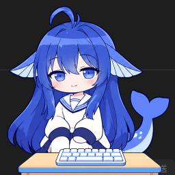
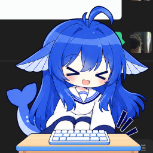

# 鲸鱼娘 Bongo Cat

> 敲键盘的时候，屏幕角落的鲸鱼娘会跟着拍桌子。



一个 Windows 桌面宠物。原生 Rust + Win32 实现，没有 Electron、没有 WebView、没有运行时依赖，
单个 5 MB 的 exe，空闲时 CPU 占用 0%。



## 特性

- **跟着键盘动**：全局监听按键（Raw Input，不需要窗口焦点），敲左手区用左手拍，右手区用右手拍
- **不挡操作**：鼠标停在身上约 1.2 秒，她会淡出并让出点击；透明区域本来就穿透
- **透明置顶**：无边框、不进任务栏、逐像素 alpha 合成
- **会犯困**：闲置一段时间后打瞌睡，任何输入都会叫醒
- **原生设置面板**：自己绘制的界面，配色取自角色本身（没有 WebView）
- **记住位置**：拖到哪就在哪，显示器拔掉后会自动回到可见区域
- **开机自启**：可选，写 HKCU 的 Run 键

## 下载

到 Releases 下载 `BongoWhale-portable.zip`，解压双击即可。

程序没有代码签名，首次运行 Windows 可能提示「已保护你的电脑」，
点「更多信息」→「仍要运行」。它不联网，除开机自启外不写注册表。

## 从源码构建

需要 Rust 1.80+ 和 MSVC 工具链（Windows）。

```powershell
cargo run -p bongocat --release
```

产物在 `target\release\bongocat.exe`。

> **注意**：仓库里不含美术资源。没有 `assets/` 时程序会退回到一套程序化绘制的占位角色，
> 功能完整、只是不好看。正式的角色帧由 `tools/assetpack` 从原始出图生成，不进仓库。

## 项目结构

```
app/                主程序（Win32 窗口、渲染、动画状态机、托盘、设置面板）
  src/main.rs         窗口与消息循环
  src/render.rs       UpdateLayeredWindow 图层
  src/anim.rs         动画状态机
  src/input.rs        Raw Input + 可选低级键盘钩子
  src/ui.rs           设置面板的自绘控件
  src/placeholder.rs  占位角色（无美术资源时使用）
tools/assetpack/    美术加工命令行工具
scripts/            构建与打包脚本
installer/          NSIS 安装脚本
```

## 实现要点

- **分层窗口**：`UpdateLayeredWindow` + 预乘 BGRA 的 DIB，每帧一次 memcpy + 一次窗口更新，
  合成交给 DWM。没有 60fps 空转循环，定时器只在需要换帧时唤醒。
- **键盘监听**：默认 `RIDEV_INPUTSINK` 的 Raw Input，不注入、不用钩子；少数全屏独占游戏里
  收不到时可以在设置里切到 `WH_KEYBOARD_LL`。
- **命中测试**：分层窗口由系统按逐像素 alpha 判定，透明处自动穿透，所以不需要鼠标钩子。
- **状态配准**：每个动作是单独出图的，各图之间有 1.5%–2.5% 的缩放/位移差，直接切会跳；
  构建时会以膝部为锚点把各状态重采样到同一套几何。

## 已知限制

- 拍击是 3 帧动画，快速连打时观感偏跳——要做骨骼动画需要分层的美术源文件
- 少数全屏独占游戏里可能收不到键盘事件
- 仅支持 Windows 10/11 64 位

## 致谢与声明

- 角色形象为个人原创，配色借鉴 DeepSeek 的品牌蓝，**与本项目无隶属或背书关系**
- 「Bongo Cat」的概念源自网络迷因，本项目的代码与角色均为独立实现

## License

代码以 MIT 协议发布，详见 [LICENSE](LICENSE)。
角色形象与美术资源不在本协议范围内。
